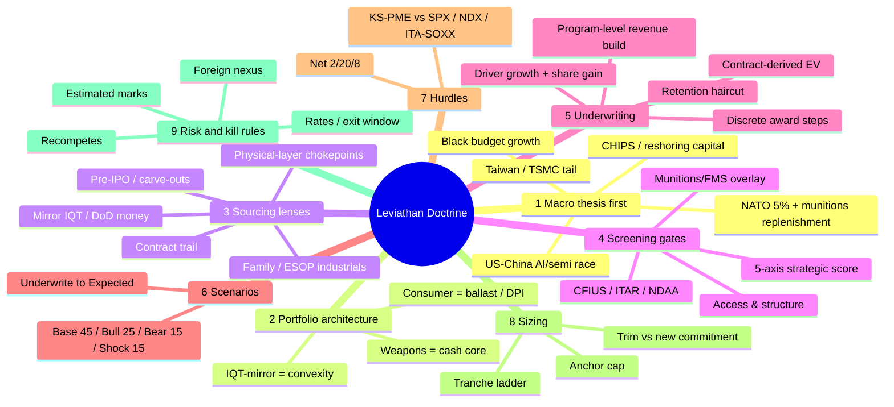
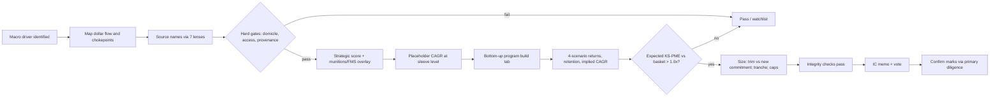

# Investment Thinking Framework: How I Find, Analyze and Select PE Targets

*Derived from the Leviathan Core PE Holdco IC model (v1 and v2) and its build history: Faxon, L3Harris Missile Solutions, Golden Dome. All $ in USD millions unless noted. Last updated Nov-2026.*

---

## 0. The Map



---

## 1. Prime Directive

**Top-down thesis → bottom-up proof → priced against the right benchmark.**

1. **Start with a structural, multi-year macro or geopolitical shift, not a company.** The current shift is the US-China AI and semiconductor race, layered on a decade-long Western rearmament cycle, with a Taiwan/TSMC contingency as the convex tail.
2. **Find where capital has to flow because of that shift**: budgets, procurement lines, multiyear contracts, CHIPS money, intelligence funding.
3. **Find the chokepoints on that flow**, meaning the physical or technical nodes where only one or a few suppliers exist.
4. **Get in privately, before the public re-rate.** The theme is already loudly priced in public markets (ITA +29% 1-yr, SOXX +170% 1-yr as of Jun-26). The edge is not spotting the theme. The edge is the entry point: private, VC, pre-IPO, family-owned or carve-out stakes.
5. **Judge success against the thematic alternative, not cash.** If owning ITA/SOXX would have done as well, the private-market illiquidity, fees and diligence cost were wasted. The scoreboard is **KS-PME vs a Defense+Semis basket**, with SPX and NDX as floors.

> One-line summary: *Own the US sovereign fail-safe stack and the physical munitions supply chain at private-market entry prices, sized so the book is convex to a Taiwan/decoupling shock and cushioned by uncorrelated consumer ballast.*

---

## 2. Portfolio Architecture: a Barbell with a Ballast

Every target has to fill a **role**. A good company that fills no role is a pass.

| Sleeve | Size | Return driver | Duration | Role in book | Behavior in TSMC-Shock |
|---|---|---|---|---|---|
| **IQT-mirror (deep tech)** | $250M (29%) | Onshoring capex, sovereign compute | Longest | Convex optionality, tail hedge | ++ (convex) |
| **Weapons (physical layer)** | $405M (47%) | Defense opex: budgets, conflict, replenishment | Medium | Cash-generating supercycle core | ++ (conflict demand) |
| **Consumer / Value** | $200M (23%) | Consumer cycle, DTC and wellness | Shortest | Ballast and near-term DPI engine | − (inflation, spending pullback) |
| **Holdco** | **$855M** | | | 29 positions | Net long the shock |

**Construction logic**
- IQT-mirror and Weapons are both long the same geopolitical supercycle through different legs: **capex** (building the domestic stack) and **opex** (consuming munitions).
- Consumer is the **only deliberately uncorrelated** sleeve. It produces DPI early and is the one sleeve that gets hurt in the shock scenario. That is acceptable, because it is there for liquidity and correlation, not for upside.
- **Sizing protects the book, not the thesis.** In the Bear case every hold period loses capital (net MOIC below 1.0x), and the losses come from the IQT seed names and Consumer. Position sizes cap the damage.

**Sub-structure inside the IQT sleeve: wartime-function clusters**

| Cluster | Names | % sleeve | Why it exists |
|---|---|---|---|
| TSMC-alternative packaging and substrates | Substrate, ThinTronics, EUV Tech | 53% | Build and package chips domestically if Taiwan is blockaded |
| Denied-environment edge AI | Syntiant, EdgeCortix | 25% | Onboard AI when GPS, cloud and comms are jammed |
| Post-Moore next-gen compute | Infleqtion, Diraq, Mueon | 20% | Quantum and ultra-dense compute as a hedge on legacy-node competition |
| Autonomous sensing (adjacent) | DefendEye | 3% | Optionality |

**Rule:** cluster by the *function the asset serves in the threat scenario*, not by SIC code or sector label.

---

## 3. The Thesis Engine: Drivers Mapped to Sleeves

I don't own a theme unless I can name the **dollar flow** behind it and its **direction of impact** on each sleeve.

| Driver | Evidence I anchor on | IQT | Weapons | Consumer |
|---|---|---|---|---|
| NATO / EU rearmament | Hague 5%-of-GDP pledge (3.5% core + 1.5% related, to 2035); EU and Canada +20% in 2025; Rheinmetall +40%/yr | + | ++ | 0 |
| US budget, Replicator, munitions | Multiyear munitions buys, Tomahawk MYP to 1,000+/yr, PAC-3 600→2,000/yr, THAAD 96→400/yr | + | ++ | 0 |
| Classified / black budget | ~$170–215B FY26 (16–20% of topline, rising); IC budget +14.2% YoY | ++ (IQT is the CIA's investment arm) | ++ | 0 |
| China modernization / decoupling | PLA budget about +7%/yr; export controls; entity list | ++ | + | − |
| Taiwan / TSMC shock | "Davidson window" (2027); TSMC is the single point of failure | ++ convex | ++ | − |
| CHIPS / reshoring capital | CHIPS LOIs (e.g. ThinTronics $50M) | ++ | + | 0 |
| Golden Dome | FY27 request $17.5B (mostly reconciliation-dependent) | + | ++ (interceptor SRMs) | 0 |
| Higher-for-longer rates | Compresses long-duration terminal multiples, delays exits | − | −/0 | − |
| USD strength / inflation | Hits import- and hardware-exposed consumer names | 0/− | 0 | −− |

**Second-order reasoning I apply**
- A growing intelligence budget means a bigger IQT deployment pipeline, which means **more signal to mirror**. The edge scales with the black budget, so it is a second, independent driver.
- Demand that runs through multiyear procurement contracts is **backlog-cushioned**. That is why the munitions overlay adds CAGR even in the Bear case (+0.4%/pt).
- Rates mostly hit the **exit timing** of the IQT sleeve (duration and DPI) rather than its fundamentals. They are a timing risk, not a thesis risk.

---

## 4. Sourcing Lenses: Where I Look

1. **Mirror sophisticated government money.** IQT, DIU, DARPA, AFWERX and CHIPS awards are a free diligence signal, because the government has already validated the technology's strategic value. Mirror the portfolio and size by strategic function.
2. **Physical-layer chokepoints in the munitions chain.** Look for the unglamorous tier-2 and tier-3 nodes that primes cannot easily replace: forgings (Ellwood, Superior & Grand Valley), energetics (Helicon), warhead-case machining (Faxon), solid rocket motors (L3Harris MSL). Capacity there is physically constrained and requalifying a supplier takes years.
3. **Follow the contract trail.** FPDS and SAM awards, IDIQ awardee lists, multiyear procurement announcements and sources-sought notices. A $473M BLU-136/B award tells you more than an aggregator's revenue estimate ever will.
4. **Pre-IPO and corporate carve-outs.** Parents spinning out segments, such as L3Harris taking MSL public with a DoW $1B convertible preferred. Enter at a cornerstone or pre-IPO discount to the expected IPO value.
5. **Hard-to-access private ownership.** Family-owned (Ellwood), ESOP-owned (ARA), closely held listed companies (H&K). Few competing bidders means a structural pricing advantage, in exchange for structuring friction. Use minority or structured preferred stakes.
6. **Allied-nation strategics with liquidity events.** IAI's IPO attempt and Elta consolidating into it.
7. **Secondary markets for marks.** Forge and similar venues give real-time pricing for late-stage names (e.g. Quince, Whoop in Consumer). Prefer market-priced marks over estimates.

---

## 5. Screening Gates: How a Target Gets In or Out

### 5.1 Five-axis Strategic Score (IQT / deep tech)

Score each axis 1–5. Weighted composite:

| Axis | Weight | Question |
|---|---|---|
| China AI/semi-race criticality | 25% | Does it advance US leadership in AI compute or advanced nodes? |
| Taiwan / TSMC insulation | **30%** | Does it reduce US dependence on Taiwan fabrication? |
| Government / defense embeddedness | 15% | IQT, DoD, DIU, DARPA, CHIPS pull? |
| CFIUS-clean / US-sovereign | 15% | US domicile and ownership; acquirable by US government or primes? |
| Supply-chain chokepoint leverage | 15% | Sole or near-sole source at a critical node? |

**Shock CAGR = Base CAGR + (Composite − 2.5 pivot) × 8% per point.**
- Example: Substrate composite 4.85 → +18.8% premium → 22% + 18.8% = **40.8%** shock CAGR.
- Example: DefendEye composite 1.70 → −6.4% drag.
- **Interpretation:** a composite above 4.0 makes the name core sovereign exposure; 2.5–4.0 makes it a partial winner; below 2.5 it is a drag in the scenario I am explicitly hedging, so it needs a non-thesis reason to be held.

### 5.2 Munitions / FMS Overlay (Weapons)

- **Munitions shortage score (0–5)** and **FMS / export backlog score (0–5)**. Exposure score = their average.
- CAGR uplift per exposure point: Base +0.5%, Bull +0.8%, Bear +0.4% (backlog cushion), Shock +0.6%.
- Example: Saronic exposure 2.5 → Base 26% + 1.25% = 27.25%.
- IAI scores 5/5 on both and gets the maximum uplift. Pure R&D shops (ARA) score lower.

### 5.3 Hard Gates (pass or fail before any modeling)

| Gate | Pass condition | If it fails |
|---|---|---|
| Domicile / CFIUS | US-sovereign, or allied with minority-only structuring | Minority only and a capped size (EdgeCortix, Diraq) |
| ITAR / foreign ownership | Structure exists to hold (cornerstone, CDR, block) | Reduce or pass |
| NDAA / Blue UAS provenance | Clean supply chain | Provenance diligence before any US-defense thesis credit (DefendEye) |
| Access | Real route to a stake (primary, secondary, cornerstone, structured pref) | Flag as "access-constrained" and keep it as a placeholder |
| Entry mark source | Priced round, secondary print or contract-derived EV | Flag "estimate" and confirm through cap-table access before IC |

---

## 6. Underwriting Method: Program-Level Bottom-Up Builds

Sleeve-level CAGR assumptions are **placeholders**. Every position eventually gets a bottom-up build. The pattern, from the Faxon and MSL builds:

```
For each program / end-market line:
  Program CAGR (scenario) = Supercycle driver growth (scenario) + Share gain (scenario)
Revenue_t                 = Σ programs  FY26E rev × (1 + program CAGR)^t
                          + Discrete award steps (e.g. NGP production: start year, full-rate $, ramp yrs)
EBITDA/EBIT margin        = linear ramp from FY26E to scenario exit margin over N years
Cash                      = EBITDA × FCF conversion (retained, no dividends)
Exit equity               = Exit EBITDA × exit multiple − net debt + cash
Implied equity CAGR       = (Exit equity / Entry post-money)^(1/hold) − 1   → feeds the sleeve
```

**Principles embedded in the builds**
1. **Revenue is built from contracts, not from aggregators.** Faxon's FY26E is $60M from the program build. An aggregator showed about $21M, which was judged stale against a $473M award.
2. **Every program line is tied to one named driver** with a sourced basis (Tomahawk MYP, MOP replenishment, PrSM FY27 request, and so on).
3. **Binary events are modeled as discrete steps, not smoothed into growth.** Example: NGP GBU-76/B production starts in year 3 in Base, year 2 in Bull, and never (t = 99) in Bear.
4. **Recompete and expiry risk show up in the Bear case.** The BLU-136/B order period ends 30-Sep-26, so the Bear case assumes a partial loss on recompete.
5. **The entry valuation is triangulated from the contracts.** Faxon: Bear $21M / Base $76M / Bull $194M at 25/50/25 gives a probability-weighted EV of $91.75M, so the $92M post is fair rather than a discount.
6. **Pre-IPO entry = IPO value × (1 − discount).** MSL: 2027E EBIT $574M × 22x = $12.6B, minus a 15% pre-IPO discount = **$10.7B entry**. Post-IPO dilution from warrants and equity comp is 3%.
7. **Dilution is explicit.** Proceeds = Check × (1 + CAGR)^Hold × Retention.
   - IQT retention: 0.85 / 0.78 / 0.68 at 5 / 7 / 10 years (heavy venture dilution, net of follow-on reserve)
   - Weapons retention: 0.92 / 0.88 / 0.82 (mature cap tables)
8. **Implied entry multiple sanity check.** Faxon $92M ÷ $8.4M EBITDA = 10.95x, within the range for defense precision machining. LHX trades at 15.1x and RHM at 17.3x.

---

## 7. Scenario Architecture

| Scenario | Weight | What it represents |
|---|---|---|
| **Base** | 45% | Supercycle continues at funded budget levels |
| **Bull** | 25% | Accelerated procurement, multiple expansion, faster exits |
| **Bear** | 15% | Budget slip, recompete losses, exit-window closure, venture write-downs |
| **TSMC-Shock** | 15% | Taiwan blockade or kinetic event, or hard decoupling. Sovereign names re-rate and Consumer is hurt |

**Rules**
- **Underwrite to Expected (the probability-weighted case)**, and report Base and Bear next to it so they are always visible.
- The Shock case is a **deliberately low-probability tail**. Its 10-year multiples are huge by construction. Keep the 15% weight honest and never move it to make the IC numbers work.
- Every scenario has its own driver growth, share gain, exit margin and exit multiple. No single "haircut" is applied across the board.

---

## 8. Return Math and Hurdles

**Fund terms:** 2% management fee on committed capital (full life) · 8% compounded preferred return · 20% carry · whole-fund European waterfall, no catch-up (a conservative simplification).

**Current headline (v2):**

| 7-year hold, net to LP | Base | Bull | Bear | Shock | **Expected** |
|---|---|---|---|---|---|
| Net IRR | 16.0% | 28.2% | −5.0% | 23.4% | **19.4%** |
| Net MOIC | 2.83x | 5.69x | 0.70x | 4.37x | **3.46x** |
| KS-PME vs ITA/SOXX basket | 1.06x | 2.14x | 0.26x | 1.64x | **1.30x** |
| KS-PME vs SPX | 1.55x | 3.11x | 0.38x | 2.39x | **1.89x** |

**Benchmarks (forward, deliberately tempered):** SPX 9% · NDX 13% · ITA/SOXX 50/50 basket **15%**. The trailing 5-year figure is about 26%, inflated by the AI and rearmament run, so I don't use it as the hurdle.

**Decision thresholds I apply**
- Expected KS-PME vs the thematic basket **> 1.0x** is required. Below that, buy the ETF.
- Base KS-PME vs the basket ≥ 1.0x is preferred. Today's 1.06x is thin, so I need entry discipline.
- For individual positions, Base gross MOIC should clear about 2.0x at 5 years (≈15% IRR) unless the position is ballast or a liquidity bridge.

---

## 9. Sizing and Portfolio Construction Rules

1. **Cap the anchor.** Substrate is about 32% of the IQT sleeve. Binary technology risk is capped even at maximum conviction.
2. **Tranche ladder:** Anchor/growth → Growth core → Pre-IPO/liquid → Quantum venture → Seed optionality. Size decreases with binary risk.
3. **Stakes above 15% count as a significant minority**: seek a board seat or observer rights (EUV Tech ~17%, ThinTronics ~19%, Helicon ~27%).
4. **Funding a new position is an explicit decision:**
   - *Trim* when the new name substitutes for existing exposure: Faxon was funded by cutting Superior & Grand Valley from $40M to $31M.
   - *New commitment* when the new name is additive exposure: MSL brought the Weapons sleeve from $390M to $405M and the holdco from $840M to $855M.
   - Never let a sleeve drift away from its committed size. Integrity checks enforce this.
5. **Follow-on reserve** (IQT: $25M of $250M) is used for pro-rata defense of winners. It is embedded in the retention factors.
6. **Allied or foreign names stay minority-only and smaller**, because the CFIUS ceiling limits strategic exit buyers.
7. **Liquidity laddering:** mix public and pre-IPO names (Infleqtion, Syntiant, MSL, IAI), whose DPI arrives earlier, with long-duration private names.

---

## 10. Risk Register and Kill Criteria

| Risk | Where it shows up | Mitigation / kill rule |
|---|---|---|
| **Estimated entry marks** | 6 of 9 IQT marks and most Weapons marks | Confirm through primary cap-table access before the IC vote. No vote on placeholder marks for large checks |
| **Contract recompete or expiry** | Faxon BLU-136/B (order period ends 30-Sep-26) | Model partial loss in Bear; diligence the recompete position |
| **Binary technology risk** | Substrate, quantum names | Size caps; milestone-gated tranches (Mueon needs a shipping design win) |
| **Foreign nexus / provenance** | EdgeCortix, Diraq, DefendEye, IAI | Minority-only, provenance diligence, NRFC/sovereignty covenants |
| **Theme already priced** | Public comps (SOXX +170%) | Only enter privately and at a discount; KS-PME hurdle |
| **Rates / exit window** | IQT terminal multiples, IPO timing (MSL paused Jul-26) | Hold-period flexibility (5/7/10 years); pre-IPO discount as buffer |
| **Budget dependence on reconciliation** | Golden Dome ($398M base vs $17.5B request) | Haircut the drivers; don't let Bull assumptions leak into Base |
| **Correlated factor concentration** | IQT + Weapons are both long geopolitics | Consumer ballast; position caps |
| **Access-constrained structures** | ESOP (ARA), family-owned (Ellwood) | Structured preferred, minority rights, realistic liquidity assumptions |

**Hard passes**
- No defensible route to a stake at any price.
- The thesis requires the Bull case to clear the thematic hurdle.
- The provenance or CFIUS issue can't be cured with minority structuring.
- Revenue can't be tied to identifiable contracts or programs (Weapons), or there is no government validation signal (IQT).

---

## 11. Diligence Checklist (Target Level)

**Thesis fit**
- [ ] Which driver(s) in Section 3 does this name monetize? Show the dollar flow.
- [ ] Which cluster or role does it fill? What does it replace or add to?
- [ ] Strategic score (5 axes) and/or munitions/FMS exposure score, with written justification for each.

**Commercial**
- [ ] Contract inventory: award values, periods of performance, recompete dates, IDIQ ceilings and the awardee count.
- [ ] Program-level revenue split. Is it disclosed, or estimated (flag it)?
- [ ] Customer concentration (USAF, Navy, Army, primes, FMS).
- [ ] Capacity constraints: can they deliver the ramp? What capex is needed?

**Financial**
- [ ] QoE on EBITDA; margin range against peers (defense precision machining 10–18%).
- [ ] FCF conversion after growth capex.
- [ ] Net debt, debt-like items, working capital seasonality.

**Valuation and structure**
- [ ] Entry mark source: priced round, secondary or contract-derived.
- [ ] Implied entry multiple compared with public comps (LHX, RHM, AVAV) and private reference points (Anduril, Saronic).
- [ ] Preference stack, liquidation preferences, anti-dilution, pro rata, information rights, board rights.
- [ ] Dilution path to exit (retention assumption).

**Regulatory**
- [ ] CFIUS, ITAR/EAR, FOCI, facility clearance, NDAA/Blue UAS, CMMC.

**Exit**
- [ ] Natural acquirers (primes, Renesas for EdgeCortix, and so on), IPO feasibility, secondary market depth.

---

## 12. Decision Workflow: Idea to IC



**Model hygiene:** blue cells are inputs, green cells are links and black cells are formulas. The IC Summary page contains no inputs. Every change re-runs the integrity checks: sleeve deployed equals committed, probabilities sum to 100%, axis weights sum to 100%, and the holdco ties to the sleeves.

---

## 13. How I Think: Cognitive Patterns

1. **Geopolitics → budgets → contracts → capacity → equity value.** Every link in that chain has to be evidenced.
2. **Asymmetry over averages.** I design for convexity to the scenario I believe is most mispriced (Taiwan/TSMC), then make sure the base case still pays.
3. **Physical over narrative.** Forgings, energetics, case machining and rocket motors are hard constraints. Requalifying a supplier takes years, which makes the moat physical.
4. **Mirror the smartest strategic allocator.** IQT, DoD and CHIPS money is information.
5. **Private entry is the alpha; the theme is beta.** I measure against the thematic ETF to separate the two.
6. **Contract-derived truth beats data-vendor estimates.**
7. **Discrete events stay discrete.** Production awards, IPOs and recompetes are modeled as steps.
8. **Every position funds itself or is new money, never ambiguous.**
9. **Honest tails.** The scenario weights are fixed before I look at the output.
10. **Structure solves access.** Minority, structured preferred, cornerstone and secondary blocks open up family, ESOP and foreign-owned assets that others skip.

### Blind Spots to Stress-Test (self-critique)

- **Factor concentration.** Roughly 76% of the holdco (IQT + Weapons) loads on one geopolitical factor. A durable US-China détente is a scenario the model does not include, and it would hit both sleeves at once. Consider a fifth "De-escalation" scenario.
- **Strategic scores are judgment, not data.** A ±1 point error on the TSMC-insulation axis moves shock CAGR by 2.4%. Run sensitivities.
- **Point-to-point IRR.** Proceeds are modeled as a single exit cash flow. There is no J-curve, staged deployment or interim DPI, so net IRR is overstated relative to a real cash-flow schedule and the time-weighted reality of fees.
- **The waterfall is simplified** (no GP catch-up, whole-fund). A full catch-up would lower net to LP in the upside cases.
- **Liquidity of minority stakes** in family and ESOP companies may require a deep discount at exit that the model does not capture.
- **Budget execution risk.** Requests are not appropriations: reconciliation, CRs and PPBE timing all intervene.
- **Public comps are elevated.** Using today's 15–22x exit multiples for 2031–2036 exits assumes the re-rate persists.

---

## 14. One-Page Target Scorecard (template)

| Field | Entry |
|---|---|
| Company / sleeve / cluster | |
| Driver(s) monetized and $ flow evidence | |
| Strategic composite (5-axis) / Shock premium | |
| Munitions shortage / FMS backlog / exposure | |
| Domicile / CFIUS / ITAR / NDAA status | |
| Access route and structure | |
| Entry post-money / source (priced, secondary, contract-derived, estimate) | |
| Check / ownership / board rights | |
| Implied entry multiple vs comps | |
| FY revenue (program-built) / margin / FCF conversion | |
| Base / Bull / Bear / Shock CAGR | |
| Discrete events (awards, IPO, recompete) and dates | |
| Retention @ 5 / 7 / 10 years | |
| Gross MOIC / IRR by scenario; Expected | |
| Contribution to holdco Expected KS-PME | |
| Funding: trim (which name) or new commitment | |
| Top 3 risks / kill criteria | |
| Diligence items open before IC | |
