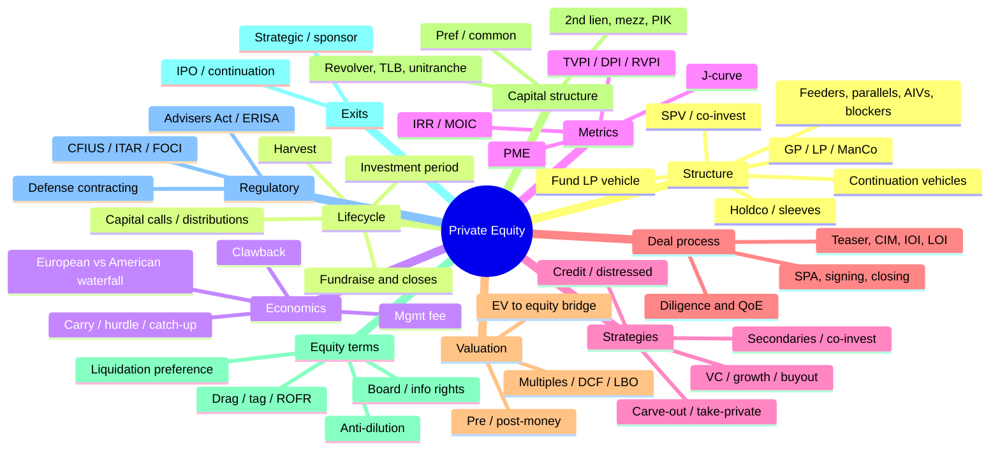
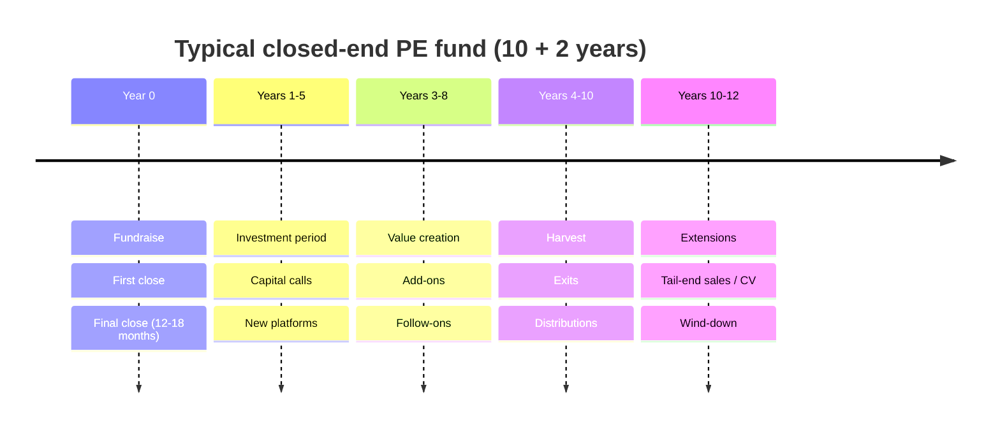
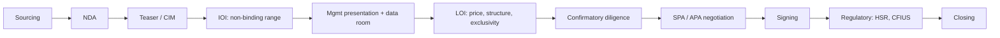

# Private Equity Essentials: Terminology, Structure and Concepts

*Reference map, organized from fund structure → economics → metrics → deals → capital structure → terms → exits → regulation. Formulas and worked examples use round numbers. Cross-references to the Leviathan model are marked ▸.*

---

## 0. The Map



---

## 1. Players and Fund Structure

| Term | Definition | Why it matters |
|---|---|---|
| **GP (General Partner)** | Entity that controls the fund and makes investment decisions; has unlimited liability (usually through an LLC) | Earns carry; legally responsible |
| **LP (Limited Partner)** | Investor in the fund (pensions, endowments, sovereigns, insurers, family offices, HNW); liability limited to its commitment | Supplies roughly 95–99% of capital |
| **Management Company (ManCo)** | Adviser entity that employs the team and receives management fees | Registered investment adviser; holds the economics of running the firm |
| **Fund (Limited Partnership)** | Usually a Delaware or Cayman LP; closed-end, about 10 years plus extensions | The legal pool of capital |
| **LPA (Limited Partnership Agreement)** | The governing contract: economics, governance, term, key person provisions | Everything is negotiated here |
| **PPM (Private Placement Memorandum)** | Offering document describing strategy, team, risks and terms | Disclosure document |
| **Subscription documents** | LP's binding commitment plus investor qualification forms | Create the legal commitment |
| **Side letter** | Bilateral LP-specific terms (fee breaks, reporting, co-invest rights, ESG or sanctions exclusions) | Usually come with an **MFN** clause |
| **MFN (Most Favored Nation)** | LP can elect any better term given to a similar-size LP | Limits preferential deals |
| **LPAC (LP Advisory Committee)** | Committee of large LPs that approves conflicts, valuations and extensions | Governance check on the GP |
| **Feeder fund** | Vehicle that pools investors (e.g. offshore, or wealth platforms) into the main fund | Tax and regulatory access |
| **Parallel fund** | Separate vehicle investing side-by-side pro rata (e.g. for ERISA, non-US or tax-sensitive LPs) | Same deals, different wrapper |
| **AIV (Alternative Investment Vehicle)** | Deal-specific vehicle used for tax or regulatory reasons | Routes particular investments |
| **Blocker corporation** | Corporation interposed to block UBTI (US tax-exempts) or ECI (non-US investors) | Tax efficiency for specific LPs |
| **SPV (Special Purpose Vehicle)** | Single-asset vehicle, often for co-investment or one deal | Concentrated exposure, deal-by-deal economics |
| **Co-investment** | LP invests directly alongside the fund in one deal, usually at low or zero fee and carry | Lowers blended fees; lets the GP write bigger checks |
| **Fund of funds** | Fund that invests in other PE funds | Diversification at the cost of two layers of fees |
| **SMA (Separately Managed Account)** | Single-LP custom mandate | Custom terms, typically large LPs |
| **Evergreen / semi-liquid fund** | Open-ended vehicle with periodic subscriptions and redemptions (common in wealth channels) | No fixed term; liquidity gates |
| **Continuation vehicle (CV)** | GP-led secondary: assets move from an old fund to a new vehicle, and existing LPs choose to roll or sell | Extends the hold on winners |
| **Holdco** | Holding company owning stakes across sub-portfolios or sleeves | ▸ Leviathan = $1,406M holdco across three sleeves |
| **Sleeve** | Distinct sub-strategy or sub-fund within a vehicle | ▸ IQT-mirror / Weapons / Consumer |
| **GP commitment** | GP's own capital in the fund (typically 1–5%) | Alignment ("skin in the game") |
| **Key person clause** | Investment period suspends if named individuals leave | Protects LPs against team risk |
| **No-fault divorce** | LPs can remove the GP or end the investment period by supermajority without cause | Ultimate LP lever |

---

## 2. Fund Lifecycle



| Term | Definition |
|---|---|
| **Commitment** | Total capital an LP agrees to provide over the fund's life |
| **First / final close** | First and last dates LPs can join; later closers pay an equalization interest |
| **Capital call (drawdown)** | GP requests a portion of commitments, usually with about 10 business days' notice |
| **Paid-in capital (PIC)** | Cumulative capital actually called |
| **Unfunded commitment** | Commitment not yet called |
| **Dry powder** | Industry-wide or fund-level uncalled capital available to invest |
| **Investment period** | Window (about 5 years) in which new platforms can be acquired |
| **Harvest period** | Post-investment period: follow-ons and exits only |
| **Recycling** | Reinvesting early proceeds (up to a cap) instead of distributing them |
| **Distribution** | Cash or stock returned to LPs |
| **Distribution in kind** | Distributing shares (e.g. post-IPO stock) instead of cash |
| **Subscription line (capital call facility)** | Bank loan secured by LP commitments; delays calls and **inflates IRR** |
| **NAV loan** | Fund-level borrowing secured by portfolio NAV; used for liquidity or follow-ons |
| **Vintage year** | Year of first investment or first close; used for peer comparison |
| **Follow-on reserve** | Capital set aside for existing portfolio companies ▸ IQT $25M of $250M |

---

## 3. Fund Economics

### 3.1 Fees
| Term | Definition | Typical |
|---|---|---|
| **Management fee** | Annual fee to the ManCo | 1.5–2.0% of **committed** capital during the investment period, stepping down to **invested** capital or a lower rate afterward ▸ model uses 2% of committed for the full life |
| **Fee offset** | Share of transaction and monitoring fees credited against the management fee | 80–100% offset today |
| **Transaction / monitoring fees** | Fees the GP charges portfolio companies | Increasingly offset or banned |
| **Organizational expenses** | Fund formation costs charged to the fund (capped) | e.g. $1–3M cap |
| **Fund expenses** | Audit, admin, legal, broken-deal costs | Charged to the fund |

### 3.2 Carry and Hurdle
| Term | Definition |
|---|---|
| **Carried interest (carry)** | GP's share of profits, typically 20% (10–30%) |
| **Preferred return (hurdle)** | Minimum LP return before carry is paid, usually 8% compounded annually |
| **Catch-up** | After the pref, the GP takes a large share (often 100%) until it has caught up to its 20% of *total* profits |
| **European (whole-fund) waterfall** | Carry only after LPs have received **all contributed capital plus pref** across the entire fund. LP-friendly |
| **American (deal-by-deal) waterfall** | Carry paid on each realized deal (usually after returning that deal's cost plus allocated expenses). GP-friendly; needs a clawback |
| **Clawback** | GP must return carry already received if the final fund result doesn't support it |
| **Escrow / holdback** | Part of carry withheld to secure the clawback |
| **Hard vs soft hurdle** | Hard: carry only on profits *above* the hurdle (no catch-up). Soft: once the hurdle is met, carry applies to all profit (with catch-up) |

### 3.3 Worked Waterfall: $100M fund, $250M gross proceeds, 5-year single exit

Pref = 100 × (1.08⁵ − 1) = **$46.93M**. Total profit = $150M.

| Tier | Full catch-up (soft hurdle) | No catch-up (hard hurdle) ▸ Leviathan |
|---|---|---|
| 1. Return of capital (LP) | 100.00 | 100.00 |
| 2. Preferred 8% (LP) | 46.93 | 46.93 |
| 3. GP catch-up (100%) | 11.73 *(= 46.93 × 20/80)* | — |
| 4. Remaining split 80/20 | LP 73.07 / GP 18.27 | LP 82.46 / GP 20.61 |
| **GP carry total** | **30.00 (= 20% of 150)** | **20.61** |
| **LP total (before fees)** | **220.00** | **229.39** |

Fees are then deducted: 2% × $100M × 5 years = $10M. The difference between the two waterfalls (about $9.4M here) grows with performance.

---

## 4. Performance Metrics

| Metric | Formula | Notes |
|---|---|---|
| **MOIC (multiple on invested capital)** | Total value ÷ invested capital | Ignores time. Gross (deal level) vs net (to LP) |
| **IRR (internal rate of return)** | Discount rate r such that Σ CFₜ/(1+r)ᵗ = 0 | Time-weighted. Sensitive to timing and to subscription lines. Single-exit shortcut: MOIC^(1/T) − 1 |
| **TVPI (total value to paid-in)** | (Cumulative distributions + NAV) ÷ PIC | Net multiple, realized plus unrealized |
| **DPI (distributions to paid-in)** | Cumulative distributions ÷ PIC | "Cash-on-cash." What LPs care about most in tight markets |
| **RVPI (residual value to paid-in)** | NAV ÷ PIC | Unrealized portion; TVPI = DPI + RVPI |
| **PME (public market equivalent)** | Compares PE cash flows with an index | Answers "did I beat the index on the same cash-flow timing?" |
| **KS-PME (Kaplan–Schoar)** | Σ Distₜ×(I_T/Iₜ) + NAV_T, divided by Σ Callₜ×(I_T/Iₜ) | >1.0 = beat the index. Single in/out: MOIC ÷ (1+r_index)^T ▸ 5-yr Base 2.42 ÷ 1.09⁵ = 1.57x vs S&P 500 |
| **Direct Alpha** | IRR of index-compounded cash flows | Annualized excess return over the index |
| **Long–Nickels PME (LN-PME / ICM)** | Implied IRR from investing the same flows in the index | Can break down with large distributions |
| **J-curve** | Early negative returns (fees, write-downs) before value creation and exits turn the curve up | Subscription lines flatten it artificially |
| **Gross-to-net spread** | Gross IRR − net IRR | Typically 4–7 percentage points for buyout (fees, carry, expenses) |
| **Loss ratio** | % of capital invested in deals returning < 1.0x | Measures underwriting discipline |
| **Quartile ranking** | Performance versus same-vintage peers | Top quartile matters; dispersion is large in VC |

**Common traps:** IRR can be gamed with subscription lines and quick flips. MOIC ignores time. Interim NAVs are Level 3 marks (judgment). Always look at DPI and PME together.

---

## 5. Strategies

| Strategy | Profile | Typical control / leverage | Return driver |
|---|---|---|---|
| **Venture capital** (pre-seed → Series A/B/C → late) | Pre-profit, high growth, power-law outcomes | Minority, no leverage | A few outsized winners |
| **Growth equity** | Revenue scaling, near or at profitability | Minority, little leverage | Revenue growth |
| **Buyout / LBO** | Mature, cash-generative | Control, 4–7x debt/EBITDA | EBITDA growth, deleveraging, multiple |
| **Take-private (P2P)** | Buying a listed company | Control | Re-rating plus operational improvement |
| **Carve-out / spin-off** | Buying a division from a corporate parent | Control or minority | Standalone efficiency; TSAs |
| **Buy-and-build / roll-up** | Platform plus add-on acquisitions | Control | Multiple arbitrage (buy add-ons at 6x, consolidate at 12x) |
| **Minority / structured equity** | Preferred with downside protection | Minority, structured | Contractual returns plus upside ▸ Ellwood, ARA |
| **Pre-IPO / crossover** | Last private round before listing | Minority | Discount to IPO price ▸ IAI cornerstone, Syntiant |
| **PIPE** | Private investment in public equity | Minority | Discount plus terms ▸ Infleqtion |
| **Secondaries, LP-led** | Buying LP fund interests | Passive | Discount to NAV, shorter J-curve |
| **Secondaries, GP-led** | Continuation vehicles, strip sales | Varies | Extending winners |
| **Private credit / direct lending** | Senior loans to sponsor-backed companies | Lender | Floating-rate spread |
| **Mezzanine** | Subordinated debt plus warrants | Lender | 12–15% blended |
| **Distressed / special situations** | Stressed balance sheets | Loan-to-own | Restructuring |
| **Infrastructure / real assets** | Long-duration contracted cash flows | Control | Yield plus inflation linkage |

---

## 6. Deal Process



| Term | Definition |
|---|---|
| **Proprietary deal** | Sourced outside a banker auction; less competition |
| **Auction (broad / limited)** | Banker-run process with rounds of bids |
| **Teaser** | Anonymous 1–2 page summary |
| **CIM (Confidential Information Memorandum)** | Detailed sell-side book |
| **IOI (Indication of Interest)** | Non-binding first-round valuation range |
| **LOI (Letter of Intent) / term sheet** | Second-round proposal; usually grants **exclusivity** |
| **Data room (VDR)** | Repository of diligence documents |
| **QoE (Quality of Earnings)** | Accounting diligence normalizing EBITDA |
| **Commercial diligence** | Market, customers, competitive position ▸ contract inventory and program build |
| **Confirmatory diligence** | Legal, tax, IT, environmental, insurance, HR and regulatory diligence after the LOI |
| **SPA / APA** | Stock or Asset Purchase Agreement |
| **Reps & warranties** | Seller statements of fact; breaches are indemnified |
| **R&W insurance (RWI)** | Policy covering rep breaches; reduces escrow needs |
| **Indemnification / escrow** | Seller's post-close liability and the cash held to secure it |
| **MAC / MAE** | Material adverse change clause allowing walk-away |
| **Locked box vs completion accounts** | Fixed historical balance sheet vs post-close true-up |
| **Earn-out** | Contingent consideration tied to future performance |
| **Rollover equity** | Sellers or management reinvest part of their proceeds |
| **TSA (Transition Services Agreement)** | Parent keeps providing services to a carve-out temporarily |
| **HSR** | US antitrust pre-merger filing |
| **Sign-to-close** | Gap between signing and closing, covered by covenants |

---

## 7. Valuation

**Enterprise value to equity value bridge**

```
Equity Value = Enterprise Value − Debt − Preferred − Minority interest − Debt-like items (leases, pensions, deferred rev*) + Cash
```

| Term | Definition |
|---|---|
| **EBITDA / Adjusted EBITDA** | Operating cash proxy. "Adjusted" removes one-offs, and is where sellers inflate the number |
| **Run-rate / pro forma EBITDA** | Annualized latest results plus synergies or acquisitions |
| **EV/EBITDA, EV/EBIT, EV/Revenue** | Core multiples ▸ LHX 15.1x and RHM 17.3x EV/EBITDA; Saronic ~46x EV/revenue |
| **Trading comps** | Multiples of similar listed companies |
| **Precedent transactions** | Multiples paid in comparable M&A (include a control premium) |
| **DCF** | PV of free cash flow plus terminal value (Gordon growth or exit multiple) |
| **LBO analysis** | Maximum price a sponsor can pay and still hit its target IRR |
| **Pre-money / post-money** | Value before / after new money. Post = Pre + new investment. Ownership = Check ÷ Post ▸ Hermeus $35M ÷ $1.0B = 3.5% |
| **Fully diluted** | Counts options, warrants and convertibles |
| **Option pool shuffle** | Pool created in the pre-money, so the dilution falls on existing holders |
| **Down round / flat round** | New price below / equal to the prior round |
| **409A** | Independent common-stock valuation used for option strikes |
| **ASC 820 / Level 3** | Fair-value accounting. Private marks are model-based (Level 3) |
| **Probability-weighted value** | Σ pᵢ × Valueᵢ across scenarios ▸ holdco 7-yr Expected 4.63x = 45% × 3.56x + 25% × 7.79x + 15% × 1.05x + 15% × 6.14x |
| **Control premium / minority discount / DLOM** | Adjustments for control and lack of marketability |

---

## 8. Capital Structure and LBO Mechanics

**Stack (senior → junior):** Revolver → Term Loan A → Term Loan B / Unitranche → Second lien → Senior/sub notes → Mezzanine / PIK → HoldCo PIK → Preferred equity → Common equity (sponsor + management).

| Term | Definition |
|---|---|
| **Revolver (RCF)** | Drawable working-capital line |
| **TLA / TLB** | Amortizing bank loan / institutional, mostly bullet, floating rate |
| **Unitranche** | Single blended senior loan from a direct lender |
| **Second lien** | Junior secured claim on the same collateral |
| **Mezzanine** | Subordinated debt with warrants or equity kicker |
| **PIK (payment-in-kind)** | Interest accrues to principal instead of being paid in cash |
| **Leverage** | Debt ÷ EBITDA (total, senior, net) |
| **Interest coverage / FCCR** | EBITDA ÷ interest; (EBITDA − capex − tax) ÷ fixed charges |
| **Maintenance vs incurrence covenants** | Tested quarterly vs only when taking an action |
| **Cov-lite** | No maintenance covenants (common in TLB) |
| **Sources & uses** | Table showing where the money comes from and where it goes |
| **Dividend recap** | Borrow to pay the sponsor a dividend (DPI without an exit) |
| **Deleveraging** | Using FCF to repay debt, which increases equity value |
| **Management Incentive Plan (MIP) / sweet equity** | Management equity, often 5–15% of common, with ratchets |

**Worked LBO.** Entry EBITDA $50M × 10x = EV $500M, funded with 5x debt ($250M) and $250M equity. Year 5: EBITDA $80M × 10x = EV $800M; net debt paid down to $120M, so equity = **$680M**.
- MOIC = 680 ÷ 250 = **2.72x**; IRR = 2.72^(1/5) − 1 = **22.2%**
- **Value-creation bridge:** EBITDA growth (30 × 10x) = $300M · Multiple expansion = $0 · Deleveraging = $130M · Total = **$430M** gain

---

## 9. Equity Terms (Venture, Growth, Minority)

The terms that protect a minority investor matter most for stakes like the Leviathan ones.

| Term | Definition | Investor-friendly version |
|---|---|---|
| **Liquidation preference** | Paid before common in an exit | 1x non-participating is standard; >1x or participating is aggressive |
| **Participating preferred** | Gets its preference back *and then* shares pro rata | "Double dip"; often capped (e.g. 3x) |
| **Seniority** | Order among preferred series | Senior vs pari passu |
| **Anti-dilution** | Price protection in down rounds | Full ratchet (strong) vs broad-based weighted average (standard) |
| **Pro rata / preemptive right** | Right to keep ownership % in future rounds | Key for follow-on reserves |
| **ROFR** | Right of first refusal on share transfers | Controls the cap table |
| **Tag-along (co-sale)** | Minority can sell alongside the majority on the same terms | Essential minority protection |
| **Drag-along** | Majority can force the minority to sell | Minority wants a price floor or threshold |
| **Protective provisions / vetoes** | Consent needed for new senior securities, sale, debt, budget | Key minority control |
| **Board seat / observer** | Governance or visibility | ▸ Seek one at >15% ownership |
| **Information rights** | Monthly or quarterly financials, budget, audit | Basic |
| **Redemption right** | Investor can force a buyback after N years | Liquidity path in family or ESOP-owned companies |
| **Put / call options** | Contractual exit rights | Used in structured minority deals |
| **Conversion** | Preferred converts to common (automatically at a qualified IPO) | Automatic conversion on a qualified IPO is the standard pre-IPO exit path |
| **IPO ratchet** | Extra shares if the IPO prices below a threshold | Pre-IPO protection |
| **Warrants** | Right to buy shares at a strike | Equity kicker; common in mezzanine and SPAC deals |
| **Convertible note / SAFE** | Early instruments converting at the next round, with cap and discount | Seed stage |
| **Pay-to-play** | Investors who don't follow on lose preferences | Penalizes free riders |
| **Dividend (cumulative / non-cumulative)** | Preferred coupon | Structured preferred usually 8–12% cumulative |
| **Vesting / cliff** | Founder and employee equity earned over time | Retention |

**Dilution and retention:** if a fund owns 10% today and new rounds sell 15%, 10% and 10%, then final ownership = 10% × 0.85 × 0.90 × 0.90 = 6.9% (retention 0.69). ▸ The model's 0.68 retention at 10 years for the IQT sleeve encodes the same idea.

---

## 10. Exits

| Route | Mechanics | Notes |
|---|---|---|
| **Strategic sale** | Sale to a corporate buyer | Synergies mean the highest price. CFIUS limits who can buy |
| **Secondary buyout (SBO)** | Sale to another sponsor | Common; "pass the parcel" critique |
| **IPO** | Listing; sponsor sells over time | **Lock-up** (usually 180 days), greenshoe, cornerstone investors |
| **Direct listing / SPAC** | Alternative ways to list | SPACs are mostly discredited post-2021 |
| **Dividend recap** | Partial liquidity through debt | No change of control |
| **Continuation vehicle** | Sell to a GP-led vehicle | Liquidity for LPs, longer hold for winners |
| **Strip sale / minority sale** | Sell part of the stake | Partial DPI |
| **Write-off** | Zero | Counts in the loss ratio |

---

## 11. Value Creation

- **100-day plan**: early priorities after close covering management, KPIs, quick wins and reporting.
- **Levers**: revenue (pricing, new markets, salesforce), margin (procurement, footprint, automation), capital efficiency (working capital, capex discipline), M&A (add-ons), capital structure (refinancing, recaps), multiple (scale, quality and growth re-rating).
- **Operating partners**: in-house operators supporting portfolio companies.
- **Buy-and-build math**: buy a $10M EBITDA platform at 10x, add $10M EBITDA of add-ons at 6x, and the combined $20M exits at 11x = $220M EV versus $160M cost before any organic growth.
- **For defense targets specifically**: capacity expansion ahead of multiyear awards, qualifying new programs, moving from tier-2 to tier-1 status, gaining FMS and export approvals, CMMC compliance, and facility clearances.

---

## 12. Regulatory and Legal

### 12.1 Fund and Investor Regulation (US)
| Term | Definition |
|---|---|
| **Investment Advisers Act / RIA / Form ADV** | Adviser registration and disclosure |
| **Accredited investor / Qualified purchaser (QP)** | Investor wealth thresholds ($1M net worth or $200K income / $5M investments) |
| **3(c)(1) / 3(c)(7)** | Investment Company Act exemptions (≤100 beneficial owners / QPs only) |
| **ERISA 25% test / VCOC** | Avoid plan-asset status if benefit-plan investors are below 25% |
| **UBTI / ECI** | Tax issues for tax-exempt and non-US LPs; solved with blockers |
| **ILPA Principles** | LP best-practice standards for terms and reporting |
| **Carried interest taxation** | Long-term capital gains treatment after a 3-year holding period (IRC §1061) |
| **QSBS (§1202)** | Capital-gains exclusion on qualifying C-corp stock held 5+ years |

### 12.2 National Security and Defense Investing
| Term | Definition | Relevance |
|---|---|---|
| **CFIUS** | Committee reviewing foreign investment in US businesses; mandatory filings for critical technology | Determines who can invest and who can buy at exit |
| **TID business** | Critical Technology, Infrastructure or sensitive personal Data, which triggers heightened CFIUS review | Most defense and semis targets |
| **ITAR / EAR** | Export controls on defense articles (USML) / dual-use items (CCL) | Limits foreign ownership and access |
| **FOCI** | Foreign Ownership, Control or Influence. Mitigated via a Board Resolution, SCA, SSA or Proxy Agreement | Required for cleared contractors with foreign investors |
| **FCL (facility clearance)** | Clearance needed to perform classified work | Valuable and slow to obtain, which makes it a moat |
| **NDAA §889 / §848 / Blue UAS** | Bans on Chinese components; approved drone list | Provenance diligence ▸ DefendEye |
| **CMMC / DFARS 252.204-7012** | Cybersecurity requirements for DoD suppliers | Compliance cost and gate |
| **Outbound investment rules** | US restrictions on investing in Chinese semis, AI and quantum | Affects allied structures |

### 12.3 Defense Contracting Vocabulary
| Term | Definition |
|---|---|
| **PPBE** | Planning, Programming, Budgeting and Execution: DoD's budget cycle |
| **Request vs authorization vs appropriation** | President's budget ask → NDAA policy limit → actual money. Only appropriations fund contracts |
| **CR (Continuing Resolution)** | Stopgap funding at prior-year levels; blocks new starts and slows ramps |
| **Reconciliation** | Budget process used for large one-off funding (e.g. much of Golden Dome) |
| **IDIQ** | Indefinite Delivery / Indefinite Quantity. A ceiling contract; revenue comes only from task orders |
| **MYP (Multiyear Procurement)** | Congress-approved multiyear buys that give suppliers visibility ▸ Tomahawk, PAC-3 |
| **LRIP / FRP** | Low-Rate Initial Production / Full-Rate Production |
| **FFP vs cost-plus** | Firm Fixed Price (contractor bears cost risk; margin upside) vs Cost-Plus (cost reimbursed plus a fee; lower risk and margin) |
| **FMS vs DCS** | Foreign Military Sales (government-to-government through DSCA) vs Direct Commercial Sales |
| **Prime / tier-1 / tier-2 / tier-3** | Position in the supply chain ▸ Ellwood, Superior & Grand Valley and Haigh-Farr are tier-2 or tier-3 chokepoints |
| **Sole source / J&A** | Non-competitive award with justification. Strong moat |
| **Recompete** | Re-bidding when a contract expires: a revenue cliff risk |
| **OTA (Other Transaction Authority)** | Fast prototyping contracts outside the FAR (DIU, consortia) |
| **SBIR / STTR Phase I / II / III** | Small business R&D awards. Phase III = production without re-competition |
| **Black / classified budget** | Unacknowledged programs; the IC funds NIP and MIP ▸ IQT funded within the NIP |

---

## 13. Formula Cheat Sheet

| Item | Formula |
|---|---|
| Ownership | Check ÷ Post-money |
| Post-money | Pre-money + New money |
| Single-exit IRR | MOIC^(1/T) − 1 |
| Rule of 72 | Years to double ≈ 72 ÷ IRR(%) (2x in 5 years ≈ 15%; 3x in 5 years ≈ 24.6%; 3x in 7 years ≈ 17%) |
| TVPI | DPI + RVPI |
| KS-PME (single cash flow) | MOIC ÷ (1 + index return)^T |
| Compounded pref | Capital × [(1 + h)^T − 1] |
| Full catch-up amount | Pref × carry ÷ (1 − carry) |
| Equity value | EV − Net debt − Preferred − Minorities − Debt-like items |
| LBO equity at exit | Exit EBITDA × Exit multiple − Exit net debt |
| Value bridge | ΔEBITDA × Entry multiple + ΔMultiple × Exit EBITDA + Debt paydown |
| Retention | Π (1 − dilution per round) |
| Probability-weighted value | Σ pᵢ × Valueᵢ |
| ▸ Leviathan proceeds | Check × (1 + CAGR)^Hold × Retention |
| ▸ Shock CAGR | Base CAGR + (Composite − 2.5) × 8% |
| ▸ Munitions-adjusted CAGR | CAGR + avg(Shortage, FMS) × uplift per point |
| ▸ Pre-IPO entry | Forward EBIT × IPO multiple × (1 − pre-IPO discount) |

---

## 14. Quick-Reference Return Targets (rule-of-thumb, net to LP)

| Strategy | Target net IRR | Target net MOIC | Hold |
|---|---|---|---|
| Large buyout | 15–20% | 1.8–2.2x | 4–6 years |
| Mid-market buyout | 18–25% | 2.0–2.5x | 4–6 years |
| Growth equity | 20–25% | 2.5–3.0x | 4–7 years |
| Venture (fund level) | 20–30%+ | 3.0x+ (top quartile) | 8–12 years |
| Secondaries | 12–18% | 1.5–1.8x | 3–5 years |
| Private credit | 9–13% | 1.3–1.5x | 3–5 years |
| ▸ Leviathan holdco (7-year, Expected) | **24.5%** | **4.63x** | 7 years |
